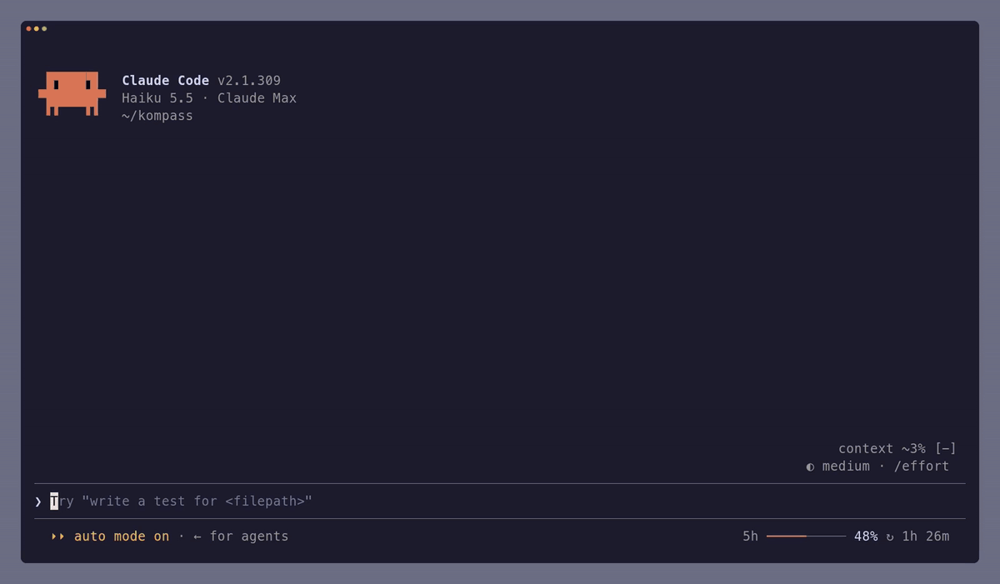

# tintname

tintname is a Claude Code plugin that gives every session a short kebab-case name and its own prompt bar color, so a handful of open sessions stay easy to tell apart.



It started as a fork of [paulchiu/claude-session-titler](https://github.com/paulchiu/claude-session-titler) and keeps its scheduling and hooks, with these changes:

- Names are 1 to 3 words of lowercase kebab-case (`rust-rewrite`, `übersicht-größe`), in the language the chat is in, umlauts kept.
- The model also picks a color that fits the subject: a Rust rewrite is orange, a globe feature is blue. Once set, it stays.
- Open sessions share their colors through one file, so no two live sessions get the same one. When all 8 are taken, the wanted color is shared.
- Renaming is conservative: the model answers `KEEP` unless the session has clearly switched topics.
- `/clear` starts over: the color claim is released, and the next prompt gets a fresh name and color.

## Install

```text
/plugin install tintname --marketplace EiSiMo/tintname
```

Pick the user scope so it runs in every project. Turn off `session-titler` if you had it, or both will name your sessions.

## How it works

The first prompt is named before it is sent: the prompt hook asks the model (Haiku by default, up to 6 seconds) and hands the name over through its `sessionTitle` field, which adds nothing to the transcript. If that gives no name, the check after the turn tries again.

After that the plugin checks after prompts 2, 4, 8 and 16, then every 8 prompts. Each check sends the current name, your first prompt, your 8 most recent prompts and Claude's latest reply. The model answers `KEEP` unless the topic clearly switched; a new name is applied silently at your next prompt.

The color is picked once, with the first name, and stays until `/clear`. A plugin can only reach the prompt bar through `/color`, so the plugin runs it once the first turn ends, and a `session.append` hook empties that run's echo and output rows as they are stored, so nothing shows in the transcript.

Colors are coordinated through `~/.claude/tintname/colors.json` (session id to color), written under a lock (`colors.lock`, a directory only one `mkdir` can create; one older than 10 seconds is treated as left by a crash). A claim counts only while its session is listed in `~/.claude/sessions/`, so ended or cleared sessions free their color by themselves. With all 8 colors held, a new session shares the color of the session idle longest, if it has been idle for 2 hours or more.

### Setting a color yourself

Run `/color <color>` (or a bare `/color`) and that color is yours: the plugin claims it for the session so other sessions avoid it, and never changes it. `/color default` releases the claim. `/clear` hands the color back to the plugin.

### Naming a session yourself

If you name a session with `/rename` or `claude --name`, the plugin sees a title it didn't set and stops for that session.

## Settings

| Option  | Default | What it does                                                                       |
| ------- | ------- | ---------------------------------------------------------------------------------- |
| `model` | `haiku` | Model that writes names and picks colors: an alias such as `haiku`, or a model id. |

## Limitations

- The first prompt waits for its name, typically 1 to 2 seconds; the color follows when the first turn ends.
- The emptied `/color` rows stay in the transcript file as `(no content)`, and the model reads those two words.
- After `/clear` the old name stays until the next prompt.
- It uses Claude Code's plugin hooks API, which is in early access and may change between releases.

## Development

You need Node 24 and Claude Code.

```bash
npm install
npm run check
```

`npm run check` runs the typecheck, lint, format check, the Vitest specs in `tests/`, `claude plugin validate` for the plugin and the marketplace, and the engine tests in `plugin/tests/` through `claude plugin test`.

To try a working copy without installing it:

```bash
claude --plugin-dir ~/path/to/claude-tintname/plugin
```

See [CONTRIBUTING.md](CONTRIBUTING.md) for the release process.

## Licence

[MIT](LICENSE)
